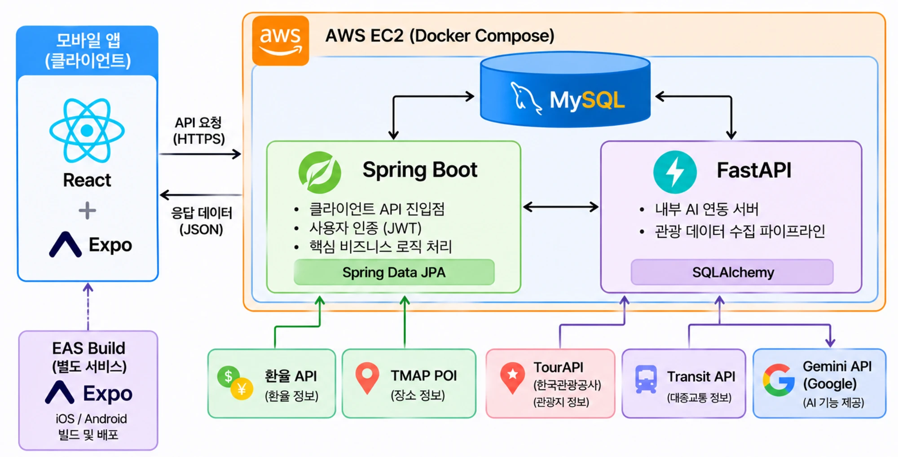

# gajaGo-server

## 프로젝트 소개
- 외국인 관광객을 위한 여행 지원 서비스

### 기능
- 알러지 정보를 고려한 음식 추천
- AI 기반 교통 경로 추천
- 축제 및 행사 정보 제공 (매일 자동 수집)
- 일정·캘린더, 여행 가계부(환율·N빵), 주변 편의시설

## 시스템 아키텍처



## 기술 스택

### Backend
- Spring Boot
- JPA
- MySQL
- Spring Security

### AI Server
- FastAPI
- Gemini API

### Frontend
- React Native

### Infra
- Docker, Docker Compose
- AWS EC2 (배포 방법: [deploy/README.md](deploy/README.md))

## 주요 기능

### 교통 챗봇

- Gemini를 활용한 출발지/목적지 추출
- Tmap POI API를 통한 위치 검증
- Tmap 대중교통 API 기반 경로 탐색 (실패하면 카카오 대중교통 경로로 다시 검색)
- 사용자 상황을 고려한 경로 추천

### 알러지 음식 필터링

- 음식-재료-알러지 구조 설계
- 알러지별 재료 매핑 테이블 구축
- 섭취 가능한 음식 목록 제공

### 축제/행사 정보

- 한국관광공사 API 활용
- 시작 시 1회 + 매일 04:00 자동 수집, 새 행사만 상세 정보 요청
- 조건별 조회 기능 제공

## API 명세
전체 엔드포인트와 처음 기획 대비 변경점: [docs/API.md](docs/API.md)

## 서버 실행 방법
서버 1대에서 `docker compose` 로 4개 컨테이너가 함께 실행됩니다.

| 서비스 | 역할 | 외부 포트 |
| --- | --- | --- |
| mysql | DB (처음 실행 시 `db/init` 의 테이블·음식 데이터 자동 입력) | 없음 |
| python-server | 교통 챗봇 (Gemini + TMAP) | 없음 |
| festival-collector | TourAPI 축제 수집 (시작 시 1회 + 매일 04:00) | 없음 |
| spring-server | 앱이 호출하는 메인 API | 8080 |

### 사전 준비
- Docker (Desktop 또는 서버용 Docker Engine), Git
- API 키: Gemini(Google AI Studio), TMAP(SK open API), TourAPI(data.go.kr 한국관광공사_국문 관광정보 서비스_GW)

### 실행
```bash
git clone https://github.com/Dankook-gajaGO/gajaGo-server.git
cd gajaGo-server
cp .env.example .env      # 값 채우기 (DB 비밀번호·JWT 키는 직접 생성: openssl rand -base64 48)
docker compose up -d --build
```
- Swagger: `http://<서버 주소>:8080/swagger-ui.html`
- 로그: `docker compose logs -f spring-server` / `docker compose logs festival-collector`
- 종료: `docker compose down` (DB 데이터는 볼륨에 남음, 완전 삭제는 `docker compose down -v`)

### 데이터
- 음식: `db/food_result.csv` + `db/make_food_seed.py` 의 알러지 매핑 → `python db/make_food_seed.py` 로 `db/init/02_food_seed.sql` 재생성
- `db/init` 은 DB 볼륨이 처음 만들어질 때만 실행됨

### 앱 연결
- 앱(`gajaGO-web/eas.json`)의 `EXPO_PUBLIC_API_BASE_URL` 을 이 서버의 공개 주소로 설정한 뒤 APK를 빌드
- 노트북 사설 IP(192.168.x.x)로 빌드한 APK는 같은 와이파이에서만 동작하므로 배포용으로 쓰지 말 것
